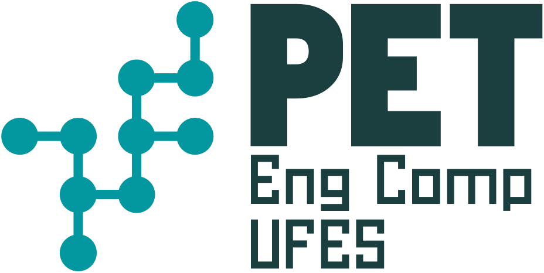

  <picture>
    <source media="(prefers-color-scheme: dark)" srcset="logo-fundo-escuro.svg">
    
  </picture>

Somos o PET Engenharia de Computação da Ufes, um grupo do Programa de Educação Tutorial formado por alunos do curso. Fazemos ensino, pesquisa e extensão, e aqui ficam os sistemas que a gente mantém.

[Site](https://pet.inf.ufes.br) · [Instagram](https://www.instagram.com/petengcomp/) · [YouTube](https://www.youtube.com/@PETEngCompUFES)
